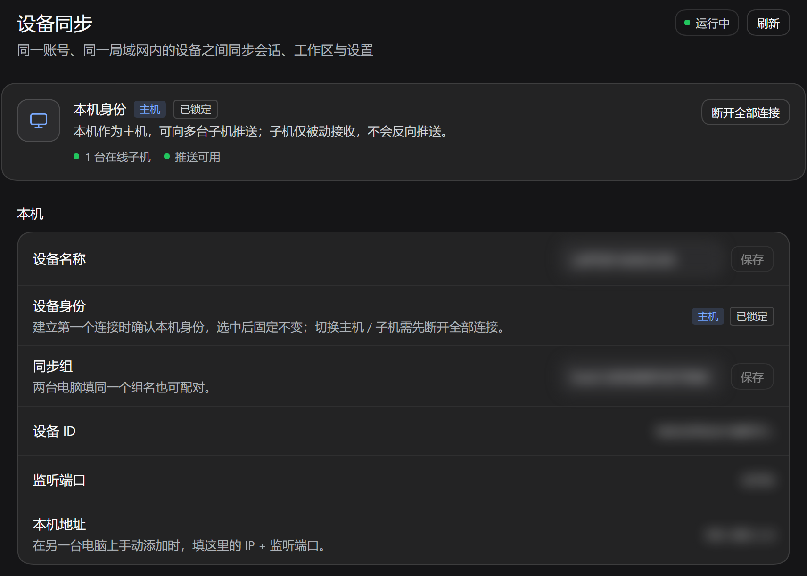

# dsh-plugin-dsh-sync

让**同一个局域网、同一个 DeepSeek 账号**登录的两台 DSH 电脑互相同步：会话记录、工作区、设置、配置与插件、附件，以及可选的缓存。

不依赖云端、不需要外网、不引入任何第三方 npm 依赖；设备之间点对点直连。



> 面板截图来自本机真实的 DSH Web 实例（深色主题）。界面按 DSH 原生风格实现：页面标题栏、分组面板、发丝分隔线、32px 控件与原生复选框，只使用 `--dsw-alias-*` 主题 token，不依赖任何 Client 组件包。同步中的进度状态见 `docs/panel.png`。

---

## 「影子工作区」已内置（0.6.0 起）

0.6.0 把原独立插件 `dsh-plugin-shadow-workspace` 合并进本插件：**只装 `dsh-plugin-dsh-sync` 一个插件**，左侧栏会同时出现「设备同步」和「影子工作区」，以及每台已配对设备的「XXX的工作区」入口。`cordis.patch.yml` 仍只有 `dsh-sync` 一行 bundle，不需要再安装、也不需要额外配置影子插件；原来安装过独立影子插件的机器卸载它即可。

- 影子功能的 host 代码位于本包 `shadow/`，与设备同步共用同一个 `dshSync` 服务：在已配对设备上真实运行会话，在本机查看输出并审批。
- 本地路由（仅本机 GUI 可访问）：`/plugins/dsh-plugin-dsh-sync/shadow`（设置页）与 `/plugins/dsh-plugin-dsh-sync/shadow/rpc`（会话数据）。
- **0.7.0 起的聊天页**按 DSH 原生观感重建：工具卡片区分读取/写入/编辑/搜索/查找/命令/后台任务，编辑显示 old/new 行级 diff 与增删行数，命令显示命令行与输出尾部，失败标红；`command/run`、`command/done`、`todo/write`、`job/registered`、`job/settled`、`model/selection`、`sandbox/mode`、`permission/preset`、`working-directory/change` 都有对应卡片或状态条；思考过程流式时自动展开、结束后折叠显示首行摘要。
- **模型选择**：聊天页 header 与「新会话」页都可以选模型（数据来自 A 端的 `ext.shadow.models`），切换即调用 `ext.shadow.select-model`，A 端做 owner 校验并记审计；失败会在页面上明确提示。
- **0.8.0 起支持提问与计划审批**：A 端 agent 调 `ask_user_question`（含 `plan-review`）时，B 端聊天页输入框位置会显示提问卡（单选/多选、自定义文本、单题跳过/全部跳过、提交）；plan-review 显示「计划待审」条 + 标题 + 两行摘要 + 查看全文 + 要求修改/同意执行。答案经 `ext.shadow.answer-question` 回传，A 端做 owner 校验并记审计（不记正文）；「要求修改」以 `ASK_CANCELLED` 让 agent 回到编辑器；B 离线或 60s 到期时交回 A 端本地官方 UI，不会静默自动同意。
- **诊断**：设置页显示「影子插件 vX.Y.Z / 对端 vX.Y.Z」；聊天页每批事件都会把类型计数写入 `$DSH_HOME/shadow-workspace/debug.log`（`client/chat events {...}`），可确认工具/提问事件是否到达客户端。
- 影子插件的状态仍在 `$DSH_HOME/shadow-workspace/`（`state.json`、`sessions.json`、`audit.jsonl`、`debug.log`），与 0.1.1 相同，升级后已有设置继续生效。
- **0.9.0 起支持分块文件推送**：设置页「显示对端」页在对端开启接收后出现「推送文件到对端」选择器，经同一条影子加密通道按块传输（`ext.shadow.push-file` 的 `begin/chunk/commit/abort`），默认 64 MB 上限、commit 时校验 sha256，文件落在对端 `$DSH_HOME/shadow-uploads/<安全文件名>`。接收端**默认关闭**，需在「本机共享」页打开「接收对端推送的文件」，或在插件配置里设 `shadow.uploads.enabled: true` / 按设备授权。每次传输只记审计（文件名、字节数、对端、结果），不记内容；同名文件永不覆盖（自动加 ` (1)` 后缀）。
- **0.10.0：影子聊天对齐原生 DSH**。转录按「用户消息 → 过程组 → 回复 → 尾部操作」分组（748px 内容列、6/12/16px 原生间距）；过程组默认折叠成一行「已完成 · 已思考 3.0s · 3 次工具调用」，运行中自动展开并显示 spinner；思考折叠为一行「思考」+ 首行摘要，流式时自动展开、结束后收起并显示耗时；工具行 24px、13px 摘要，编辑显示带行号的 unified diff（绿/红底色）、命令显示 `$ cmd` + 输出与退出码、读取/搜索显示路径与匹配数、后台任务显示 job 卡片、待办显示清单、失败标红；助手 Markdown 支持表格横向滚动、代码块语言栏 + 复制按钮、流式光标；用户气泡与时间戳、回复复制按钮、相对时间；加载骨架、空状态、断线/错误条、贴底跟随与「回到底部」；composer 为原生卡片式（自增高输入框、工具栏内模型/推理强度选择、运行中停止按钮、Enter 发送）。全部使用 `--dsw-alias-*` token，零 npm 依赖。截图见 `docs/shadow-chat.png`（headless Edge + mock 路由渲染真实组件）。0.10.25 起 composer 底部三个「外观件」已接通为真实功能（见下一条）。
- **0.10.25：影子 composer 的权限选择 / 文件上传 / 语音输入全部接通，并修复提问卡与滚动跟随**。
  - 权限 chip 打开原生风格预设菜单（仅可查看 / 工作区内修改 / 完全权限 / 自动审查 EXP），高危预设先风险确认；经新增 `ext.shadow.permissions` 落到对端 `permissionPresets`，旧版对端保持只读。截图 `docs/shadow-chat.png`。
  - `+` 打开「添加」菜单：图片或文件分块暂存到对端（`ext.shadow.attach`），发送时由对端内联图片 / 铸文件回执，走原生同一条附件准入链路；composer 卡片内显示附件栏与进度。截图 `docs/shadow-chat.png`。
  - 麦克风：浏览器录音 → 16 kHz PCM16 WAV → 本机 Host `speechToText`（插件自有路由 `shadow/src/speech.js`）转写 → 插入草稿；模型未准备时提示「下载并准备」。截图 `docs/shadow-chat.png`。
  - 已回答的提问卡不再固定停在输入框上方（改为转录里持久的「提问 · n/m 已回答」工具行，展开可看答案）；滚动跟随改为原生阈值 25px + 每次提交贴底 + ResizeObserver，用户离开底部才解除并显示「回到底部」。截图 `docs/shadow-chat.png`。
- **0.10.18：左侧栏底部的影子入口 1:1 复刻原生工作区列表**。运行时从当前构建的样式表发现 `dsh-client-ui-workspace` 的行/区头类名并直接复用，因此 34px 工作区行、32px 会话行、36px 区头、缩进、14px 标题 / 10px 时间、`folder↔chevron` 悬停交换、`…` / `＋` 悬停显隐、`展开其余 N 个会话` / `收起`（5 条水量线）与原生逐像素一致；图标取自 `@deepseek-ai/dsh-client-ui-primitives` 的原始 path。交互同构：点工作区折叠/展开（`aria-expanded` + localStorage）、点会话进影子聊天、`＋` 新建影子会话、`…` 原生样式菜单、800ms 悬停卡片、当前会话高亮、待审批 warning 点 + 「待审批」、运行中 spinner；5px 滚动槽常驻但 thumb 仅在鼠标进入影子块时显示（不抖动行宽）。截图与逐元素对齐结果见 `docs/shadow-sidebar.png` / `docs/shadow-sidebar.png` / `docs/shadow-sidebar.png` / `docs/shadow-sidebar.png`（无头复刻台 `_launcher_harness`，真实 client.js + 原生 CSS + mock 路由）。
- **0.10.24：影子工作区顶部对齐（紧贴原生会话列表尾部）**。停靠目标回到原生会话列表的滚动容器本身，影子块作为其最后一个子节点，顶部紧接最后一个原生会话（8px 间距），不再被推到 footer 上方底部对齐；会话多时随列表滚动，footer 与影子块之间留白。
- **0.10.23：模型/推理等级弹层对齐原生二级三级界面**。一级弹层两行「模型 / 推理等级」+ 当前值 + `›`；「模型」二级面板带 `搜索模型…` 过滤、按 provider 分组、当前项高亮勾选；「推理等级」二级面板为 `Default/Low/High/Max`（Default 跟随模型默认）；弹层锚定 composer 卡片顶部、Esc/外点/resize 关闭。
- **0.10.22：composer 模型/思考强度对齐原生 + 修复过程组闪烁**。模型/强度改为原生单一紧凑触发器（`模型名 + High + 单个 chevron`，宽度随标签、13px/500、hover 底色），点击弹原生风格菜单（模型按 provider 分组 + 思考强度分组、选中勾选、Esc/外点关闭）；补原生麦克风占位图标。过程组开合改由 turn 级 `live` 决定：运行中始终展开（标签不闪），turn 结束自动收起「已完成，用时 X」，用户手动开合优先。
- **0.10.21：侧栏细节对齐原生 + 对端工作区重命名 + 更稳的停靠**。「影子工作区」分组标题与「展开其余 N 个会话」改回原生灰（运行时取原生元素实测色，`rgb(173,178,184)` = `label-tertiary`），工作区名/会话名/时间保持纯白；移除影子会话标题左侧返回按钮；设置页「显示对端」每个工作区支持重命名（仅本机显示，存 `localStorage`，分组标题/悬停卡/设置页即时生效，真实名称仍保留在副标题）；停靠方式改为 `regionArea` 最后一个 flex 子节点——原生列表在上方滚动、影子块固定在 footer 之上，任何窗口高度都不遮挡且无需滚到列表底部。
- **0.10.20：影子工作区停靠进原生工作区列表，不再遮盖、文本纯白**。原生 `sidebar.workspaces` 是 `kind=single` 槽且已被原生工作区列表占用（插件注册第二个 entry 会被丢弃），所以 launcher 改为 DOM 停靠：探测包含全部原生工作区/会话行的最外层滚动容器，把影子块作为最后一个子节点放进去，并用 `MutationObserver` 维持顺序；影子块随原生列表滚动，小窗口/低分辨率下不会覆盖原生工作区。文本（标题/工作区/会话/时间/图标）统一纯白 `#fff`；探测失败时回退 fixed 悬浮，底边按原生 `_footArea` 实测高度定位。截图见 `docs/shadow-sidebar.png`。
- **0.10.19：影子会话窗口 1:1 复刻原生 DSH 会话页**。聊天页按 `ui-conversation` / `ui-chat` / `ui-tool` 的真实 DOM + CSS module 类名重建（运行时按后缀发现，兼容数字开头 hash 与 shell/primitives 的 `_<key>_<hash>_<line>` 形态）：页面骨架为原生 `root[data-phase=active] → header(51px) → body → scrollBody → viewArea + composerSeat(sticky)`；内容列宽复刻 `clamp(680, bodyWidth×.64, 920)`（1440 宽 = 920px，composer 卡片 = 952px、28px 圆角）；用户气泡 20px 圆角/14-22、助手 markdown 用原生作用域（表格 `_tableScroll` + `md-table-wide`、代码块原生 banner）、过程组 `TurnProcessNodeView` 折叠行、思考行 24px、工具行 `DisclosureRow` 24px + 展开 `ioCard`、尾部时间/用时/复制、原生 34px 圆形发送/停止与静态权限 chip。找不到原生类名时整页回退到旧的 `sdc-*` 实现。截图见 `docs/shadow-chat.png`（无头复刻台 `_chat_harness`）。

---

## 同步什么

| 范围 | 内容 | 合并方式 |
| --- | --- | --- |
| `sessions` | `$DSH_HOME/sessions/<项目>/<会话>/session.v*.jsonl.zstd` | 追加日志：远端是本机前缀时只追加尾部；两边分叉时保留本机并把远端存进 `conflicts/` |
| `workspace` | `$DSH_HOME/storages/workspace.json` | 结构化并集：工作区、会话 id 合并，同 id 取 `updatedAt` 较新者；**归档/置顶列表只保留本机的，不并入对端** |
| `storages` | `storages/` 下其它数据（如 `schedule.json`） | 最后写入者优先（mtime + 设备 id 决定平局） |
| `profile` | `profiles/<profile>/` 的 `package.json`、`cordis.patch.yml`、`cordis.yml`、`pnpm-workspace.yaml`、`plugins/` | `package.json` 增量合并；`cordis.patch.yml` 只合并模型白名单块，其它内容不动；`cordis.yml` 等按机器保护；`plugins/` 按文件镜像（一级 junction 会解引用成真实文件） |
| `modules` | `profiles/<profile>/node_modules/` 里**真实目录**的包（不传 junction/链接、原生二进制与 pnpm 元数据） | 按文件同步，最后写入者优先；**永不传播删除**、不生成 `.bak-sync-*`；每轮有 `maxModulesBytes` 上限 |
| `credentials` | `$DSH_HOME/.credentials.yaml` 的 `refs:` 段中仅 `*API_KEY` 的条目 | 行级合并：只补本机缺的 API Key；已存在且值不同保留本机并记冲突；`records:` 与账号 token **永不复制** |
| `attachments` | `$DSH_HOME/attachments/` | 按文件同步，最后写入者优先 |
| `cache` | `$DSH_HOME/cache/`（默认关闭） | 按文件同步，最后写入者优先 |

**不同步**：`.credentials.yaml` 的 `records:` 段与账号类 ref（`BUDDY_ACCOUNT_*`、`WORKBUDDY_ACCOUNT_*` 等）、`logs/`、`backups/`、profile 里 `node_modules` 的链接/符号链接与 `.pnpm`/`.bin` 目录/`.modules.yaml`、原生二进制（`*.node/*.dll/*.so/*.dylib/*.exe`）、插件自己的 `dsh-sync/` 状态目录、各类锁文件与临时文件。

删除会以「墓碑」形式传播（内容哈希 + 上次同步水位双重校验），但有两条硬保护：会话日志永不删除；本机已修改过的文件不会被对端墓碑删掉（会保留并记录一条提示）。插件目录例外：删除只在**本机**生效，不会传播到对端（避免误删另一台正在用的插件）。

## 插件是怎么同步的

插件属于 `profile` 集合（`$DSH_HOME/profiles/<profile>/`），但不同文件走不同策略：

| 文件 | 策略 |
| --- | --- |
| `plugins/**` 源码 | 逐文件索引（大小 + mtime + 内容哈希），按 last-write-wins 镜像；本机删除不回拉、不传播；覆盖前留 `.bak-sync-*`。`plugins/<name>` 若是**一级 junction/符号链接**（开发目录链进来），会解引用成真实文件同步（只解一层，目标内的二级链接仍不跟随） |
| `package.json` | 增量合并：本机 `dependencies`、`devDependencies`、`dsh.profile.bundles` 全保留；对端新增项要过「本机可解析」过滤（见下）；本机版本优先，不删条目 |
| `cordis.patch.yml` | **只合并白名单模型块**（`@deepseek-ai/dsh-agent-default-model`、`@deepseek-ai/dsh-llm-*`），文件其它字节逐字节保留；块级冲突时保留本机并记 `model-config-conflict`，不再生成整文件 `.conflict-*` |
| `cordis.yml`、`pnpm-workspace.yaml` | 按机器保护：对端版本只存 `.conflict-*` 并在面板记录，永不覆盖本机 |

**为什么对端新增项要过滤**：profile 只镜像 `plugins/`，不同步 `node_modules/`。0.4.1 及更早版本把对端 `dsh.profile.bundles` 全量取并集，于是本机没安装的插件也会被写进 profile，DSH 插件管理器把它们显示为「包不可用」。0.4.2 起：

- **bundle**：对端独有条目只有在 `profiles/<profile>/node_modules/<包名>`（或 DSH 安装目录里）能读到 `package.json`，且 `exports` / `main` / 入口文件至少有一个能定位时才并入；本机已有条目无论能否解析都保留，不会删除。
- **依赖**：对端独有的 `link:` / `file:` 依赖，如果本机 profile 下找不到链接目标（例如 `link:./plugins/qqbot` 但 `plugins/qqbot` 不存在）就不并入，避免 `pnpm install` 因缺失目标失败或把别的插件裁掉；registry 版本号依赖（如 `dsh-npu: 1.2.0`）会保留，方便以后安装。
- **被跳过的条目不会静默消失**：面板「冲突副本」里会出现 `bundle-unavailable` / `dependency-unavailable` 记录，写明是哪个插件、为什么没并入。等插件装好（或 `dsh plugin install` 建好 `node_modules` 链接）后下一次同步会自动并进来。
- 取舍：DSH 自带的 bundle（如 `@deepseek-ai/dsh-base`）不在 profile 的 `node_modules` 里。如果对端多出一个**本机 DSH 版本没有**的内置 bundle，会被当成「不可用」跳过并记录冲突；升级 DSH 后重新同步即可。自定义安装路径可用 `bundleRoots` 配置或 `DSH_SYNC_BUNDLE_ROOTS` 环境变量（`;` 分隔）补充可解析的包目录。

不同步：`plugins/**/node_modules/**`、`.git`、`*.node` / `*.dll` / `*.so` / `*.dylib` / `*.exe` / `*.map`；插件自己的数据目录（如 `$DSH_HOME/qqbot`）也不在 profile 里，不随插件代码同步。

落地后需要重启 DSH 才会加载新插件。0.4.3 起依赖包也会同步（见下节），通常不再需要手动 `dsh plugin install`。

## 插件依赖同步（modules）与 profile 自愈

**为什么需要**：profile 同步的是声明与 `plugins/` 源码，`node_modules/` 以前的版本不参与同步。于是只有 A 装了某插件时，B 会「有声明、没有包」，插件页显示「包不可用」，只能靠 U 盘/手工拷贝 `node_modules`。0.4.3 增加 `modules` 集，把可移植的依赖包同步过去，并在本机自动补齐链接与声明。

DSH profile 的 pnpm 布局是 `nodeLinker: hoisted`（见 `profiles/<profile>/node_modules/.modules.yaml`）：顶层是**真实目录**，插件则通常是 `plugins/<name>` 的 junction + `node_modules/<name>` 的 junction。`modules` 集的规则：

| 内容 | 处理 |
| --- | --- |
| 真实目录里的包文件（如 `undici/`、`@liustack/modsearch/`） | 按文件同步（大小 + mtime + 哈希，LWW） |
| junction / 符号链接 | **不索引、不同步**（指向本机源码，复制过去没有意义） |
| `.pnpm/`、`.bin/`、`.ignored/`、`.modules.yaml`、`.pnpm-workspace-state-v1.json` | 跳过（pnpm 元数据与本机状态；`.bin/` 只跳过该目录下的内容，包内 `*.bin` 数据文件照常同步） |
| `*.node`、`*.dll`、`*.so`、`*.dylib`、`*.exe`、`*.map` | 跳过（原生二进制与本机/平台绑定，源映射没必要传） |
| 删除 | **永不传播**（一方卸载包不会删另一方的） |
| 回写 | 不生成 `.bak-sync-*`（避免体积翻倍） |
| 体积 | 每轮每个 peer 最多 `maxModulesBytes`（默认 256MB），超限剩余文件延后到下一轮并在面板记 `modules-over-limit` |

**profile 自愈（每个同步轮末尾自动执行，纯本地、离线可用）** `repairLocalProfile()`：

1. 读本机 `profiles/<profile>/package.json`；解析失败就**什么都不做**（绝不覆盖本机唯一副本）。
2. 对 `link:`（以及指向本 profile 内的 `file:`/`portal:`）依赖：目标目录存在 → 补建/修正 `node_modules/<name>` junction（只删链接本身，**绝不对真实目录递归删**，目标始终用**本机** profile 解析，不会指向对端路径）；目标不存在 → 删掉陈旧链接，并移除这条依赖声明。
3. `plugins/<name>/package.json` 存在但清单里没有声明时，自动补 `link:./plugins/<name>`（含 junction 补建）。
4. 链接目标存在且本机可解析的插件，自动补回 `dsh.profile.bundles`。
5. 本机既没有源码（`plugins/<name>/package.json`）也无法解析的 bundle 声明会被移除，面板记一条 `bundle-pruned`（`@deepseek-ai/*` 内置 bundle 一律保留，避免误删）。
6. 只有真的改了才写盘：先备份 `package.json.bak-prune-<yyyyMMdd-HHmmss>`，写 UTF-8 **无 BOM**、2 空格缩进、结尾换行；无改动不写盘、不备份，每轮只做少量 stat。

**B 机（空 node_modules）自动修好流程**：升级到 0.4.4 → 重启 DSH → 等一轮同步（插件源码 + 依赖包落地 + 自动建 junction + 清理不可用声明）→ 再重启 DSH 即可加载插件。全程不需要外网，也不需要 U 盘。

**关于插件源码的 junction（0.4.4）**：A 上 `plugins/<name>` 是指向 `D:\...` 开发目录的一级 junction 时，profile 集会**解引用**它、把目标里的真实文件同步给 B（B 收到的是实体目录），自愈再把声明/bundle/junction 补齐，因此 `dsh-npu`、`dsh-plugin-companion-memory` 这类插件不需要再手工拷贝。只解一层：目标内部的二级符号链接仍不跟随；A 本机的 junction 保持不变。注意 `dsh-npu` 依赖本机 NPU 运行时（`flm.exe` 等），在**没有 NPU 硬件的机器**上装好后 DSH 可能报加载/启动错误，需要在该机删掉该插件或其 `plugins/npu` 配置。

## 模型 API 设置与密钥同步（0.4.4）

设置界面的模型供应商配置有两个位置，同步策略不同：

| 内容 | 位置 | 策略 |
| --- | --- | --- |
| 模型/供应商块 | `profiles/<profile>/cordis.patch.yml` 里 `name` 为 `@deepseek-ai/dsh-agent-default-model`、`@deepseek-ai/dsh-llm-*` 的顶层条目 | **白名单块定向合并**：首次同步采用对端块；之后只有对端改过就采用对端；两边都改过保留本机并记 `model-config-conflict`；文件其它字节（本机路径、端口、其它插件块）逐字节不动 |
| API Key | `$DSH_HOME/.credentials.yaml` 的 `refs:` 中名字以 `API_KEY` 结尾的条目（如 `OPENCODE_GO_API_KEY`） | **只补本机缺的 key**；两边都有但值不同 → 保留本机并记 `credential-conflict`；多行/块格式的值不自动合并，记 `credential-skipped` |

安全边界：

- `.credentials.yaml` 的 `records:` 段（设备/账号 token）与 `BUDDY_ACCOUNT_*`、`WORKBUDDY_ACCOUNT_*` 等账号类 ref **永不复制**；本机缺失该文件时也不会整文件复制，而是新建只含 `version: 1`、`records: {}`、`refs:` + 对端 API Key 的最小文件。
- 传输仍在既有的 X25519 + AES-256-GCM 加密通道里；日志与冲突记录**不打印密钥值**，只写 key 名。
- 写回前若本机 `.credentials.yaml` 在 `stableAfterMs`（默认 2s）内刚被改动过，会跳过本轮（运行中的 DSH 可能在内存态回写该文件），下轮再试。
- 合并**不受「谁的文件 mtime 更新」门控**：模型块按块级水位做三方合并、凭据只补缺失的 `*API_KEY`，所以即使本机文件被 DSH 运行时回写得比 A 新，对端新增的模型块/API Key 仍会合并进来；合并后按 journal 驻留，对端文件没变时不会重复拉取或写盘。
- 只合并「`*API_KEY`」类型，因此更换供应商 key 的场景可以跨机同步；账号登录态（OAuth token/设备身份）永远不会跨机。

两边都升级后：A 的模型设置与 API Key 会在 B 的下一轮同步里出现。**`cordis.patch.yml` 与 `.credentials.yaml` 都可能被运行中的 DSH 以内存态回写，写回后需要重启 DSH 才能在设置界面看到新值。** B 机流程同样是「升级 → 重启 → 等一轮同步 → 再重启」。

## 安装

### 用发布包安装（另一台电脑）

把 `dist/dsh-plugin-dsh-sync-0.5.1.zip` 解压到任意目录，双击 `install.cmd`：

- 默认装到 `%USERPROFILE%\.dsh\profiles\desktop`；
- 其它 profile 或自定义 `DSH_HOME`：

  ```powershell
  .\install.ps1 -Profile desktop
  .\install.ps1 -Profile desktop -DshHome "D:\my-dsh-home"
  ```

安装脚本会复制插件、登记 `package.json` 的 dependency 与 bundle、建立 `node_modules` junction，并在改动前备份 `package.json.bak-sync-install-*`。写回 `package.json` 时使用**无 BOM 的 UTF-8**（0.4.2 起；旧版用 PowerShell 5.1 的 `Set-Content -Encoding utf8` 会写 BOM，DSH `JSON.parse` 会直接崩）。完成后重启 DSH。

包内还带 `安装说明.md`，包含卸载与常见问题。

### 通过插件管理器

```text
plugin_manager install_bundle target=<绝对路径>\dsh-sync
```

安装后在「设置 → 插件」确认 `dsh-sync` 行为启用，重启 DSH。

### 手动安装（源码目录）

```powershell
node scripts\install-profile.mjs            # 默认安装到 $env:DSH_PROFILE
node scripts\install-profile.mjs --profile desktop
```

脚本会：把插件链接进 `profiles/<profile>/plugins/`、在 `package.json` 的 `dependencies` 与 `dsh.profile.bundles` 中登记 `dsh-plugin-dsh-sync`、在 `node_modules` 下建立链接，并在改动前写 `.bak-sync-install-*` 备份。完成后重启 DSH。

### 打包

```powershell
pwsh -NoProfile -File scripts/package.ps1   # 生成 dist/*.zip 与 dist/*.tgz
```

### 防火墙

首次启动时 Windows 会询问是否允许 Node/DSH 的入站连接，**需要允许专用网络**（本插件监听一个 TCP 端口用于传输、一个 UDP 端口用于发现）。只允许专用网络即可，公网配置无意义。

## 配对设备

1. 两台电脑都安装并启用插件，确认连接在同一个局域网（同一路由器 / 同一 Wi-Fi）。
2. 打开左侧栏「设备同步」面板，能看到对方的设备名与 IP。
3. 在 A 上点「配对」，A 显示 6 位校验码；在 B 上点「配对」，B 也显示 6 位。
4. **两个数字一致**时，各自点「确认配对」。SAS 相同即可排除中间人。
5. 配对信息保存在 `$DSH_HOME/dsh-sync/trust.json`，之后自动同步，无需再次确认。

> 同一账号下，`groupId` 由账号 id 哈希得到，面板会标记「同账号设备」；但**首次配对仍需人工确认校验码**，这是安全设计，不是缺陷。

### 一台能发现另一台，反过来不行

这是单向组播/广播被 Wi-Fi AP、防火墙或虚拟网卡丢掉的典型症状：B 能收到 A 的组播，A 收不到 B 的。

0.3.0 起有两条兜底：

1. **升级两台电脑到 0.3.0**：B 一旦发现 A，就会额外向 A 的地址**单播** beacon，A 不再依赖组播双向可达。
2. **手动添加**：在收不到设备的那台点「附近设备 → 手动添加」，填对方面板上的 `本机地址:监听端口`（例如 `192.168.1.20:49683`）。插件会直接走 TCP `/hello`，完全绕过 UDP 发现。

手动添加后仍需按上面的步骤比对 6 位校验码；对端如果已经能看到你，直接在你这边确认即可。手动地址保存在 `$DSH_HOME/dsh-sync/manual-peers.json`。

> 监听端口是随机的，对端重启 DSH 后端口会变；届时手动地址需要更新。升级到 0.3.0 后自动发现可免去这一步。

## 使用

- 默认每 15 秒自动同步一次；发现设备、配对完成、修改同步范围时也会立即触发。
- 面板可随时「立即同步」、查看最近日志与冲突副本。
- 冲突文件位置：
  - 会话：`sessions/<项目>/<会话>/conflicts/session.v*.jsonl.zstd.<设备>.<时间>`
  - 其它：原文件旁 `xxx.conflict-<设备>-<时间>.ext`
- 同步完成后：
  - 会话记录：关闭该会话（或重启 DSH）后从磁盘重新加载才能看到合并结果；**本机正在使用的会话不会被外部改写**，避免序列号冲突。
  - 配置与插件：重启 DSH 生效；`plugins/` 有变化时可能还需要在目标机执行一次 `dsh plugin --profile <profile> install` 来重建依赖链接。

## 手动覆盖与推送

每个已配对且在线的设备行上有两个按钮：

| 按钮 | 行为 |
| --- | --- |
| 覆盖本地 | 强制采用对端文件：逐个拉取并写入本机，覆盖前保留 `.bak-sync-*`。配置类（`cordis.patch.yml` 等）仍受保护；会话日志只追加或另存冲突，不会截断历史 |
| 推送 | 把本机文件发给对端：按哈希跳过相同文件，覆盖对端同名文件前保留 `.bak-sync-*`。会话日志只追加，配置类不覆盖（对端另存冲突），`package.json` 仍走「本机可解析才并入」的过滤合并 |

「推送」默认被安全开关挡住：先在「本机 → 允许推送」打开，按钮才会可用。开关保存在 `$DSH_HOME/dsh-sync/push-guard.json`，重启后保持。两个操作执行前都会弹出确认框。

> 这里的「云端」就是另一台电脑，插件没有中心服务器；所有传输仍在局域网内点对点完成。

## 配置

在 profile 的 `cordis.patch.yml` 中覆盖（或用面板修改同步范围）：

```yaml
- id: dsh-sync
  config:
    enabled: true
    autoStart: true
    intervalMs: 15000        # 自动同步间隔（毫秒）
    stableAfterMs: 2000      # 文件静默多久后才参与同步，保护正在写入的文件
    discovery: true          # UDP 组播发现
    discoveryPort: 47821
    seeds: []                # 组播不可用时的单播种子，如 ["192.168.1.20:47821"]
    listenPort: 0            # 0 = 随机端口；固定端口需自行保证不冲突
    deviceName: ""           # 留空使用主机名
    group: ""                # 手动指定同步组；留空用账号 id 哈希
    sets: null               # null = 全部；或 ["sessions","workspace","storages","profile","modules","credentials","attachments"]
    maxBlobBytes: 50331648   # 单个文件上限 48MB（入站也按此校验）
    maxModulesBytes: 268435456 # 插件依赖每轮每个 peer 的拉取上限 256MB
    keepBackups: true        # 覆盖前保留 .bak-sync-* 备份（modules 集不备份）
    propagateDeletes: true   # 传播删除墓碑（会话日志、工作区、插件依赖、凭据始终不删）
    skipLiveSessions: true   # 本机打开中的会话不接收远端改写
    bundleRoots: null        # 额外用于判断「本机可解析哪些 bundle」的包目录；null = 自动探测
    repairProfile: true      # 每轮末尾自动修复本机 profile（补 junction、补/清 bundle 声明）
    mergeModelConfig: true   # cordis.patch.yml 只合并白名单模型块（false = 整文件按机器保护）
    extRpcAllow: []          # 允许对端调用的扩展 op（ext.*）；默认空 = 全部拒绝，见「对外服务 dshSync」
    extRpcDisableAll: false  # 总开关：true 时即使插件以 allow:true 声明也一律拒绝
```

> 同步范围保存在 `$DSH_HOME/dsh-sync/sets.json`（0.4.4 起为 `version: 3`）。从旧版升级时会自动迁移：v1 文件会自动打开 `modules`，v2 文件会自动打开 `credentials`（前提是 `profile` 集开启）；关闭 `profile` 会同时关闭 `modules`。

## 对外服务 dshSync（跨机 RPC broker，0.5.x）

同 profile 的其它插件（例如「影子工作区」）不需要自己实现局域网发现、配对和加密通道：dsh-sync 通过 Cordis 服务 `dshSync` 提供受控的跨机 RPC。它**只做传输层**，不包含任何业务逻辑。

```js
// 其它插件消费方式
export const inject = ['dshSync']
export function apply(ctx) {
  const sync = ctx.dshSync              // 没有 dsh-sync 时为 undefined，需降级
  const identity = sync.identity()      // { deviceId, name, group }
  const peers = sync.peers()            // [{ deviceId, name, online, trusted, host, port, lastSyncAt }]
  const off = sync.registerRpc('ext.shadow.status', async (request, context) => {
    // request = { op: 'ext.shadow.status', payload: <调用方传来的 JSON> }
    // context.peer = { deviceId, name, host, port }
    return { ok: true, at: Date.now() }
  }, { allow: true })                   // 0.5.1：声明本 op 可被已配对设备调用，装完即用
  // 调用对端已注册的 op（未配对/离线/超时会抛可读错误，error.code 带对端错误码）
  const result = await sync.rpc(peerId, 'ext.shadow.status', { hello: 1 }, { timeoutMs: 10000 })
  const offEvent = sync.onPeerEvent(({ type, deviceId, peer }) => { /* peer / peer-lost / peer-updated / status */ })
}
```

API 一览：

| 方法 | 说明 |
| --- | --- |
| `identity()` | `{ deviceId, name, group }`（本机身份，只读） |
| `peers()` | 已知设备摘要（与面板设备列表同源）：`{ deviceId, name, online, trusted, host, port, lastSyncAt }` |
| `rpc(deviceId, op, payload?, { timeoutMs = 10000 })` | 向**已配对且在线**设备发起认证 RPC，返回对端的 JSON 结果；只能调用 `ext.*` |
| `registerRpc(op, handler, { allow = false })` | 注册本机对已配对设备提供的扩展 op，返回 dispose；`handler(request, context) => Promise<json>`；`allow: true` 表示该插件声明此 op 可被已配对设备调用（自动加入本机放行集合，仅限该 op） |
| `onPeerEvent(listener)` | 订阅 `peer` / `peer-lost` / `peer-updated` / `status`，返回 dispose |
| `engine` | **不暴露**（避免其它插件乱调内部方法） |

权限判定（0.5.1）：`extRpcDisableAll === true` → 一律拒绝；否则 **op 以 `allow: true` 注册过** 或 **`extRpcAllow` 配置匹配** → 放行；两者都没有 → `ext-disabled`。

安全边界：

- **默认关闭**：`extRpcAllow` 默认空数组，且没有插件声明 `allow: true` 时所有 `ext.*` 都返回 `ext-disabled`。两种放行方式：
  - 插件自声明：`registerRpc('ext.shadow.status', handler, { allow: true })` —— **装完即用**，不需要用户改 profile 配置；只放行这一个 op。
  - 用户配置（第二道闸，可选）：在 profile 的 `cordis.patch.yml` 里写 `extRpcAllow: ['ext.shadow.*']`（或单个 op、`'*'`）。
  - **总开关**：`extRpcDisableAll: true` 时即使插件 `allow: true` 也一律拒绝，方便用户一键封死扩展通道。
- **`allow: true` 的信任模型**：插件代码与 DSH 同信任级（能装进 profile 的插件本来就能任意读写文件），`allow: true` 只是「该插件声明自己的这个 op 可以被已配对设备调用」，**不是**任意第三方远程能注册，也不会放大已有信任：仍要求通过 `dshSync` 服务、已配对设备、`ext.` 命名、1MB/8MB 大小限制与审计日志。
- **op 命名强制 `ext.` 前缀**：必须匹配 `^ext\.[a-z0-9][a-z0-9._-]{0,63}$`，无法覆盖内置 `ping`/`manifest`/`pull`/`push`。
- 服务端只接受**已配对设备**（传输层认证 + `identity.getPeer` 双重断言），并校验请求/响应大小（请求 1MB、响应 8MB 上限，超限 `payload-too-large`/`response-too-large`）。
- 日志只记录 `ext rpc <op> from <device>` 与字节数，**不打印 payload**；冲突/日志里也不含业务数据。
- 服务随插件生命周期回收：dsh-sync 卸载/重载时 `registerRpc` 的 op 表（含 `allow: true` 声明）与 `onPeerEvent` 订阅一并清理；没有 dsh-sync 时其它插件应降级（`ctx.dshSync` 为 `undefined`）。
- 宿主没有 `ctx.provide`（老版本 Cordis）时只 log warn 不报错，dsh-sync 自身功能不受影响。
- **配置提醒**：dsh-sync 自带 bundle patch 里 insert 的 `dsh-sync` 行 config 只有 `{enabled, autoStart, intervalMs, discovery}`。如果你的插件 patch 或 profile patch 用 `- id: dsh-sync` **override** 这一行，会**整份替换**该行 config（不是深合并）——想把 `extRpcAllow`、`extRpcDisableAll` 等字段和原有字段一起保留，请把需要的字段全部写在同一份 override 里。

## 安全模型

- 每台设备首次启动生成 X25519 密钥对，设备 id = 公钥 SHA-256 前 32 位。
- 传输：HTTP + AES-256-GCM 信封，密钥由 X25519 共享密钥经 HKDF 派生；未配对的设备只能看到公开的 `/hello` 身份信息。
- 配对：6 位 SAS 由共享密钥与双方公钥推导，必须人工比对一致。
- 明文 HTTP 仅承载已加密的信封；监听地址为 `0.0.0.0`，但只接受已配对设备的 RPC。
- 每个 RPC 的 `rel` 除了「不逃出集合根」，还要通过该集合的 include/exclude 与忽略规则白名单（`setAllowsRel`）：例如 `credentials` 集根是 `$DSH_HOME`，但对端只能访问 `.credentials.yaml`，`dsh-sync/device.json`、`profiles/.../package.json` 等一律 `invalid-path`。
- 不同步 `.credentials.yaml` 的 `records:` 与账号类 ref；只同步 `*API_KEY` 类型的 ref，且本机已有不同值时永不覆盖。
- 扩展 RPC（`dshSync` 服务，`ext.*`）**默认全部关闭**：只有插件以 `allow: true` 声明、或 `extRpcAllow` 显式列出的 op 才对已配对设备开放；`extRpcDisableAll: true` 可一键全关。日志不记录 payload。

## 同步后本机插件不见了（0.3.1 及更早）

旧版把 `profiles/<profile>/package.json` 当作普通文件做「最后写入者优先」。对端较新的精简 `package.json` 会把本机的插件依赖与 `dsh.profile.bundles` 覆盖掉，DSH 重启后 QQ 机器人、NPU 等就不再加载——但插件目录其实还在 `plugins/` 里。

0.3.2 起不会再发生：`package.json` 只做合并（0.4.2 起对端新增项还要通过「本机可解析」过滤），`cordis.patch.yml` 永不覆盖。

已经发生时的恢复：

1. 在 `profiles/<profile>/` 下找 `package.json.bak-sync-<设备>-<时间戳>`，选覆盖前的那份（含 `dsh-plugin-qqbot`、`dsh-npu` 等）；
2. 复制回去覆盖 `package.json`；
3. 重启 DSH（新版本也可能热加载）；
4. 检查 `plugins/` 与 `node_modules/` 链接仍在，通常不需要重装插件；
5. 两端都升级到 0.3.2 后再重新打开「配置与插件」同步。

## 同步后工作区会话变少 / 被「归档」（0.4.1 及更早）

旧版 `mergeWorkspace` 把 `global.archivedSessionIds`、`pinnedSessionIds` 也当并集处理。归档/置顶其实是**每台机器本地的界面状态**：对端并进来的归档 id 会让 DSH 把本机正在用的会话从工作区列表里隐藏，看起来就是「工作区会话列表变空 / 变少」，而且没有任何冲突提示——这是本次事故的数据丢失表现。

0.4.2 起：`archivedSessionIds`、`pinnedSessionIds` **只保留本机的值**，不再并入对端；`workspaceIds`、`tables.workspaces[].sessionIds`、`defaultWorkspaceId` 的合并语义不变。

已经发生时的恢复（手动，1 分钟内）：

1. 打开 `$DSH_HOME/storages/workspace.json`（先备份一份）；
2. 看当前工作区的 `tables.workspaces[<id>].sessionIds`；
3. 把它里面的 id 从 `global.archivedSessionIds` 里删掉（这些 id 同时出现在 `sessionIds` 和 `archivedSessionIds` 里就是被并集污染的特征）；
4. 重启 DSH，工作区会话列表即恢复。

注意：两端都升级到 0.4.2 之前，旧版对端还可能继续把这台机器的归档列表并回去，所以建议两台机器一起升级。

## 限制与注意事项

- **只支持同一局域网**；跨网段需要 `seeds` 且路由可达，公网使用请自行加隧道（不推荐）。
- 时钟偏差会影响「最后写入者优先」的判断；建议两台机器开启时间同步。
- 删除传播只覆盖普通文件集合（设置、插件、附件、缓存）；会话日志与 `workspace.json` 永不删除。墓碑保留 45 天，之后自然过期。
- 按墓碑删除前，本机会先留一份 `<文件名>.bak-sync-deleted-*` 备份（`keepBackups` 开启时），可手动恢复。
- 删掉的文件如果在对端被修改过，对端版本会胜出并把文件恢复回来，面板里会记录一条「已用对端版本恢复」的提示。
- 会话日志采用追加合并，但**不能**把两个已经分叉的会话自动合成一棵树；分叉会保留两份（本机 + `conflicts/`）。
- 插件目录按文件镜像；0.4.3 起依赖包也同步，但仍不负责跑 `pnpm install`。插件版本差异跨机后需重启 DSH 生效。
- 插件依赖同步有单轮字节上限（`maxModulesBytes`，默认 256MB）；首次冷同步大 profile 可能分几轮完成，面板会记一条 `modules-over-limit` 提示。
- 插件源码是 `plugins/<name>` 一级 junction 时，0.4.4 起会解引用同步为真实文件（只解一层，目标内的二级链接不跟随）；A 本机的 junction 不变，但若对端内容更新且 mtime 更晚，回写会经过 junction 落在本机源码目录，开发中的插件建议先提交/备份。
- `dsh-npu` 这类依赖本机硬件的插件同步到**没有对应硬件**的机器时，DSH 可能报加载/启动错误；在该机删除插件目录或在 `cordis.patch.yml` 里禁用即可。
- 模型块与 API Key 写回后需要重启 DSH 才生效；重启前运行中的 DSH 可能用内存态覆盖文件，本插件会在文件刚变动时跳过本轮（下轮再试）。
- 缓存同步默认关闭，因为多数缓存可重建且体积不可控。
- 浏览器本地 UI 偏好（主题、语言等存在 localStorage 的设置）不在文件系统里，因此不参与同步。
- 工作区条目里的绝对路径按原样同步；两台机器目录结构不同时需要在面板/工作区里手动调整路径。
- 当前为 v0.1：无带宽限速、无明显冲突时的人工合并 UI。

## 冲突处理一览

| 场景 | 行为 |
| --- | --- |
| 两边都改同一文件 | mtime 较新者胜；平局用设备 id 决定，两端结论一致；被覆盖方保留 `.bak-sync-*` |
| 两边都改 `workspace.json` | 工作区、会话 id 并集；同 id 取 `updatedAt` 较新者；归档/置顶列表只保留本机的；`defaultWorkspaceId` 若指向不存在的工作区会自动回退 |
| 会话日志两边分叉 | 本机文件不动，对端整份存入 `conflicts/` |
| 一边删除、一边没动 | 删除同步到对端（仅普通文件集合；`modules` 永不传删除） |
| 一边删除、一边改过 | 保留改过的版本，记录提示 |
| 会话被删除 | 永不传播，避免丢历史 |
| `package.json` 两边不同 | 本机依赖与 bundle 全保留；对端新增项只有本机能解析（bundle）或链接目标存在（`link:`/`file:` 依赖）才并入，其余记 `bundle-unavailable` / `dependency-unavailable` |
| 本机 `workspace.json` 或 `package.json` 不是合法 JSON | 不覆盖本机；对端版本另存 `.conflict-*`，记一条 `invalid-local` |
| 对端改了 `cordis.patch.yml`（0.4.4） | 只合并白名单模型块；其它字节逐字节保留；块级冲突保留本机并记 `model-config-conflict`（不再生成整文件 `.conflict-*`） |
| 对端改了 `cordis.yml`、`pnpm-workspace.yaml` | 本机配置不覆盖；对端副本存为 `.conflict-*` 并在面板提示 |
| 两边模型块都改过 | 保留本机块，记 `model-config-conflict`；下一次对端再改动时再尝试采用 |
| 两边都有不同的 API Key | 保留本机值，记 `credential-conflict`（只记 key 名，不含值） |
| 对端 API Key 是多行/块格式 | 不自动合并，记 `credential-skipped`，需手工处理 |
| 自愈清掉不可用声明 | 记 `bundle-pruned` / `link-pruned`，说明哪个插件、为什么移除；源码/包回来后可再次同步 |
| 单轮插件依赖超过 `maxModulesBytes` | 本轮剩余文件延后，记一条 `modules-over-limit`（每个 peer 每轮最多一条） |
| 收到的文件超过 `maxBlobBytes` | 拒绝接收并计入同步错误（不会静默收下） |

## 开发与测试

```powershell
# 语法检查
node --check index.js
node --check client.js

# 单元 + 双实例集成测试（两个独立 DSH_HOME，真实 HTTP/加密/发现注入）
node --test --test-isolation=none "test/*.test.js"
```

测试覆盖：密钥交换与信封篡改、同步决策矩阵、工作区并集（含归档/置顶只保留本机）、bundle 可解析性过滤、`link:` 依赖过滤、本地 JSON 非法不被覆盖、追加合并、分叉冲突落盘、删除墓碑传播与复活保护、未配对拒绝、面板路由鉴权、客户端模块注册、`install.ps1` 无 BOM 产出、modules 集（junction 不索引、真实包同步、无备份、永不传删除、单轮字节上限）、profile 自愈（补 junction/补 bundle/补插件声明/清不可用声明/幂等/不指向对端路径）、plugins 一级 junction 解引用、`cordis.patch.yml` 模型块三方合并（首次采用/对端更新/本地改动保留/双方冲突/非白名单块逐字节不变/幂等）、credentials 行级合并（只并 `*API_KEY`、records 与账号 token 不复制、冲突保留本机、多行值跳过）、sets.json v1→v3 迁移、入站 `maxBlobBytes` 校验、dshSync broker（身份/peers 形态、ext.echo 往返、默认关闭、通配白名单、非法 op、未注册 op、未配对拒绝、内置 op 回归、请求/响应超限、handler 错误不泄漏 payload、dispose/重载、peer 事件订阅、`allow:true` 默认可用且只放行自身 op、`extRpcDisableAll` 总开关、allow 注册 dispose 后权限回收）。

### 本机双实例实测（2026-10-25）

用两个独立的 `DSH_HOME` 各自启动一个真实的 `dsh web` 实例（不同端口、同一台机器、同一网段），安装本插件后验证：

- UDP 发现互相看到对方设备；面板 API 配对时两边 SAS 均为 `415891`；
- 新建会话文件与附件自动出现在对端；
- 对端追加会话尾部后，本机只追加了新增字节（无冲突副本）；
- `workspace.json` 的并集合并生效；
- 反向（B → A）附件同步正常；
- 全程 `lastCycle.errors` 为空，`conflicts/` 未产生；
- 发布包（zip）在干净的临时 profile 上执行 `install.ps1` 后可正常启动，`/plugins/dsh-plugin-dsh-sync/panel` 返回运行状态，客户端模块出现在 Web 启动清单中。

## 目录

```text
index.js               Host 插件入口（apply）
client.js              Web 客户端面板
src/engine.js          同步引擎（发现、配对、协调、落盘、profile 自愈）
src/transport.js       HTTP + 加密 RPC
src/discovery.js       UDP 组播/广播发现
src/crypto.js          X25519 / HKDF / AES-GCM / SAS
src/identity.js        设备身份与信任库
src/index-store.js     文件索引与哈希缓存（按集合应用忽略规则）
src/journal.js         每对设备的同步水位
src/merge.js           决策规则、工作区合并、package.json 过滤合并、冲突命名
src/bundles.js         本机 bundle/link 可解析性探测（注入给 merge.js）
src/modelconfig.js     cordis.patch.yml 白名单模型块解析与三方合并（纯函数）
src/credentials.js     .credentials.yaml 行级合并（仅 *API_KEY refs，纯函数）
src/broker.js          dshSync 跨机 RPC broker（ext.* 注册表、默认关闭的白名单）
src/paths.js           数据目录与同步集定义（含 modules/credentials 集与集合感知忽略规则）
src/glob.js / fsutil.js / net.js / panel.js
scripts/install-profile.mjs
```

## License

与 DSH 插件生态保持一致，仅供个人使用；图标为原创 SVG。
